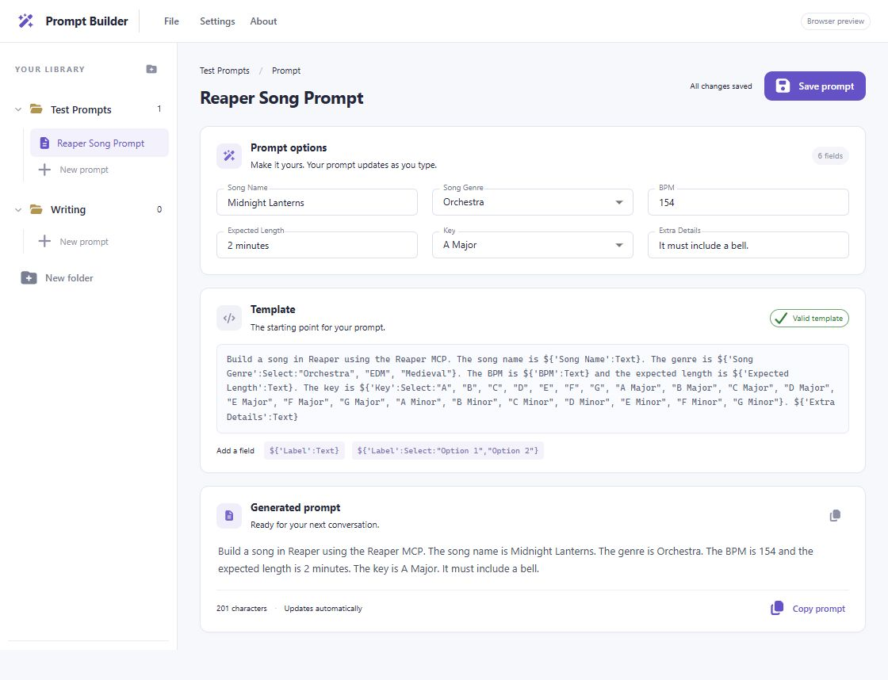

# Prompt Builder

Create reusable prompt templates, fill in their fields, and copy the finished text into your next conversation.

Prompt Builder is a desktop prompt library built with Tauri 2, React, and TypeScript. Templates turn placeholders into text inputs, dropdowns, checkboxes, and date pickers, with a live preview of the generated prompt. Save your templates and field values in a local folder of your choice. No account or API key is required.



*Browser preview with the included Reaper song template.*

## Contents

- [Features](#features)
- [Getting started](#getting-started)
- [Usage](#usage)
- [Template syntax](#template-syntax)
- [Storage](#storage)
- [Development](#development)
- [Troubleshooting](#troubleshooting)
- [Contributing](#contributing)
- [License](#license)

## Features

- **Reusable templates:** Define fields directly inside your prompt text.
- **Five field types:** Single-line text, multiline text, dropdowns, toggles, and dates.
- **Live output:** See the generated prompt update as you edit and copy it to the clipboard.
- **Organized library:** Create folders and named prompts in the sidebar.
- **Local saving:** Keep templates and values in readable JSON files in a configurable directory.
- **Explicit saves:** Save with the button, `Ctrl+S`, or `Cmd+S`. Unsaved prompts show a dot in the sidebar.
- **Template validation:** Errors include their character position and preserve the last valid options and output while you fix the template.
- **Browser preview:** Try the interface using browser storage before running the desktop app.

Prompt Builder assembles prompt text for you to copy. It does not send prompts to an AI service or execute the instructions they contain.

## Getting started

### Prerequisites

- **Node.js and npm:** Use Node.js 22.12+ within the 22.x series, 24.x, or 26+. These versions satisfy the locked Vite and Vitest requirements.
- **Rust and Cargo:** Install the stable toolchain through [rustup](https://rustup.rs/) for desktop development.
- **Platform dependencies:** Follow the [Tauri 2 prerequisites](https://v2.tauri.app/start/prerequisites/) for your operating system. Windows requires Microsoft C++ Build Tools with the **Desktop development with C++** workload, Microsoft Edge WebView2, and the Rust MSVC toolchain. macOS requires Xcode Command Line Tools for desktop builds; Linux requires the packages listed for your distribution.

After installing the tools, reopen your terminal and check:

```sh
node --version
npm --version
rustc --version
cargo --version
```

### Run the desktop app

Clone or download this repository, open a terminal in its root directory, and run:

```sh
npm ci
npm run tauri dev
```

This starts the frontend development server and opens the desktop window. The first launch compiles the Rust dependencies and may take several minutes.

### Run the browser preview

Only Node.js and npm are needed for the browser preview:

```sh
npm ci
npm run dev
```

Open [http://localhost:1420](http://localhost:1420). The interface displays **Browser preview** and saves prompts to that browser's local storage. Native directory selection and disk saving are available in the desktop app.

## Usage

1. Select an existing prompt in the sidebar. An empty library starts with an unsaved **Reaper Song Prompt** example.
2. To build your own library, choose **New folder**, then **New prompt** inside that folder.
3. Edit the prompt name and template. Valid placeholders automatically create fields in **Prompt options**.
4. Fill in the fields and watch **Generated prompt** update.
5. Choose **Copy prompt** to copy the output, and **Save prompt** to save the template and current field values.

Switching between prompts keeps your edits in memory. Reloading the library, changing the save directory, or closing the desktop window asks before discarding unsaved changes. Save each edited prompt before leaving if you want to keep it.

Open **Settings** to type or browse for a save directory. Use **File → Reload library** to load changes made to library files outside the app.

## Template syntax

A placeholder has a quoted label and a case-sensitive field type:

```text
${'Label':Type}
```

### Field types

| Type | Example | Behavior |
| --- | --- | --- |
| `Text` | `${'Topic':Text}` | Single-line text input; starts empty. |
| `TextArea` | `${'Details':TextArea}` | Multiline input; preserves line breaks in the output. |
| `Select` | `${'Tone':Select:"Friendly", "Professional", "Concise"}` | Dropdown; defaults to the first choice. |
| `Toggle` | `${'Comments':Toggle:"Include comments.", "Omit comments."}` | Checkbox; inserts the first version when checked and the second when unchecked. Starts unchecked. |
| `Date` | `${'Due date':Date:"MM/DD/YYYY"}` | Date picker; starts empty and renders the selected date in the specified format. |

`TextArea` spans two columns and two rows in the options grid, or one column on narrow screens. A `Toggle` requires exactly two quoted versions; either version may be empty to omit text.

### Example

Paste this into a prompt's template editor:

```text
Write a ${'Tone':Select:"Friendly", "Professional", "Concise"} summary about ${'Topic':Text}.

Use these notes:
${'Notes':TextArea}

${'Include next steps':Toggle:"End with three practical next steps.", ""}
The deadline is ${'Deadline':Date:"MMMM D, YYYY"}.
```

With **Tone** set to `Professional`, **Topic** set to `the product launch`, **Notes** set to `The launch is scheduled for next month.`, the checkbox checked, and **Deadline** set to November 1, 2026, the output is:

```text
Write a Professional summary about the product launch.

Use these notes:
The launch is scheduled for next month.

End with three practical next steps.
The deadline is November 1, 2026.
```

### Date formats

Supported tokens are `YYYY`, `YY`, `M`, `MM`, `MMM`, `MMMM`, `D`, `DD`, `ddd`, and `dddd`. Use separators between tokens and square brackets around literal text.

```text
${'Date':Date:"YYYY-MM-DD"}
${'Meeting':Date:"ddd, MMM D, YYYY"}
${'Timesheet':Date:"MMMM D, YYYY [timesheet]"}
```

Dates can be typed, picked from the calendar, or cleared. The selected date is saved as `YYYY-MM-DD`; changing the display format keeps that date.

### Parsing and editing rules

- Labels and choices accept single or double quotes, with whitespace around delimiters.
- Inside quoted values, escape quotes and backslashes with a backslash. `\n`, `\r`, and `\t` are also supported.
- Repeating a label reuses one field, provided its type, choices, and date format match.
- Fields appear in the order they occur in the template.
- Compatible field values survive valid template edits. Switching between `Text` and `TextArea` preserves the text; removing a selected dropdown choice resets it to the first available choice.
- Toggle state survives edits to its checked and unchecked versions.
- Plain text without placeholders is valid. Field values are inserted as literal text.
- Invalid templates show an error and cannot be saved until corrected.

## Storage

The desktop app defaults to a **Prompt Builder** folder inside your system's Documents directory. Library folders are real subdirectories, and each saved prompt is an `<id>.prompt.json` file:

```text
Prompt Builder/
└── Writing/
    └── example-123.prompt.json
```

A prompt file contains its identifier, name, template, field values, and last saved timestamp:

```json
{
  "id": "example-123",
  "name": "Summary",
  "template": "Summarize ${'Topic':Text}.",
  "values": {
    "Topic": "the product launch"
  },
  "updatedAt": "2026-10-13T12:00:00.000Z"
}
```

Prompt IDs keep filenames stable when a prompt is renamed. Changing the save directory opens the library at that location; it does not move your existing files. Back up or share a library by copying its folders and prompt files.

Directory preferences are stored in `settings.json` in Tauri's platform app configuration directory. Saves write a temporary sibling file before renaming it into place. Malformed prompt files produce warnings and remain untouched. Folder names and prompt IDs are validated, and linked paths outside the library are rejected.

Browser preview data is separate from the desktop library and stays in the browser's local storage. Clearing browser data removes saved preview prompts.

## Development

The frontend uses React 19, TypeScript, Vite, Material UI, Font Awesome Free icons, and Day.js. The desktop backend uses Tauri 2 and Rust for directory preferences and filesystem storage.

### Commands

Run these commands from the repository root:

| Command | Purpose |
| --- | --- |
| `npm ci` | Install the dependencies pinned in `package-lock.json`. |
| `npm run dev` | Start the browser preview at `http://localhost:1420`. |
| `npm test` | Run the template parser and generation tests with Vitest. |
| `npm run build` | Check TypeScript and build the frontend into `dist/`. |
| `npm run preview` | Serve the built frontend after running `npm run build`. |
| `npm run tauri dev` | Start the desktop app with frontend live updates. |
| `cargo test --manifest-path src-tauri/Cargo.toml` | Run the Rust storage tests. |
| `npm run tauri build -- --debug --no-bundle` | Build a debug desktop executable without installers. |
| `npm run tauri build` | Build the release desktop app and installers for the host platform. |

Release installers are created in `src-tauri/target/release/bundle/`. Desktop builds require the Rust toolchain and platform dependencies above.

### Project structure

| Path | Purpose |
| --- | --- |
| [`src/App.tsx`](src/App.tsx) | Library interface, editing state, dialogs, and field controls. |
| [`src/App.css`](src/App.css) | Application layout and styling. |
| [`src/template.ts`](src/template.ts) | Template parsing, value reconciliation, and prompt generation. |
| [`src/template.test.ts`](src/template.test.ts) | Tests for field types, escaping, repeated fields, dates, and template edits. |
| [`src/dates.ts`](src/dates.ts) | Date validation and formatting. |
| [`src/library.ts`](src/library.ts) | Library types, sample prompt, and desktop/browser storage adapter. |
| [`src-tauri/src/storage.rs`](src-tauri/src/storage.rs) | Filesystem storage, settings, validation, and storage tests. |
| [`src-tauri/src/lib.rs`](src-tauri/src/lib.rs) | Tauri commands and plugin initialization. |
| [`src-tauri/tauri.conf.json`](src-tauri/tauri.conf.json) | App identity, window configuration, and bundling settings. |
| [`src-tauri/capabilities/`](src-tauri/capabilities/) | Desktop permissions. |
| [`docs/`](docs/) | Design reference and interface previews. |

## Troubleshooting

- **`cargo` or `rustc` is unavailable:** Install Rust through rustup and reopen your terminal. On Windows, select the MSVC toolchain.
- **Desktop compilation fails on Windows:** Check that the C++ desktop workload and WebView2 are installed. See the [Tauri Windows prerequisites](https://v2.tauri.app/start/prerequisites/#windows).
- **Windows MSI packaging fails with `failed to run light.exe`:** Check the VBSCRIPT optional feature described in the [Tauri MSI prerequisites](https://v2.tauri.app/start/prerequisites/#vbscript-for-msi-installers).
- **Port 1420 is already in use:** Stop the application using that port and retry. The development server requires this fixed port.
- **Directory controls are unavailable:** Run the desktop app with `npm run tauri dev`; browser preview uses local storage.
- **A prompt cannot be saved:** Give it a name, fix any template error, and check that the save directory is writable.
- **Clipboard copying fails:** Select the generated text and copy it manually.

## Contributing

Issues and pull requests are welcome. Include reproduction steps for bugs and describe the expected behavior for feature requests.

Before submitting code changes, run `npm test`, `npm run build`, and `cargo test --manifest-path src-tauri/Cargo.toml`. For desktop changes, also check the app with `npm run tauri dev` or a debug build.

Unless explicitly agreed otherwise in writing, contributions submitted for inclusion in this project must be offered under the project's license. Only submit material you have the right to license under those terms.

## License

Copyright © 2026 Lucas Burdell. Prompt Builder is distributed under the custom [Prompt Builder Source-Available License](LICENSE).

**You may use Prompt Builder to build commercial products. You may not turn Prompt Builder, or its protected code and assets, into a commercial product without a separate written commercial license.**

| Use | Allowed under this license? |
| --- | --- |
| Personal, educational, and research use | Yes. |
| Internal business use, including modified versions | Yes. |
| Creating prompts, content, or separate products for commercial work or paid client projects | Yes. Your own inputs and outputs are not restricted by this license. |
| Sharing original or modified copies free of charge for noncommercial purposes | Yes, with the license and required notices preserved. |
| Selling Prompt Builder or a renamed or modified version | Requires a separate written commercial license. |
| Incorporating its code or protected assets into a commercial product, including a free tier or bundled component | Requires a separate written commercial license. |
| Offering a commercial hosted version or selling access to its functionality | Requires a separate written commercial license. |

Third-party dependencies retain their own licenses. This is a source-available license with commercial restrictions, rather than an OSI-approved open-source license. The full [license text](LICENSE) controls if this summary differs from it.
